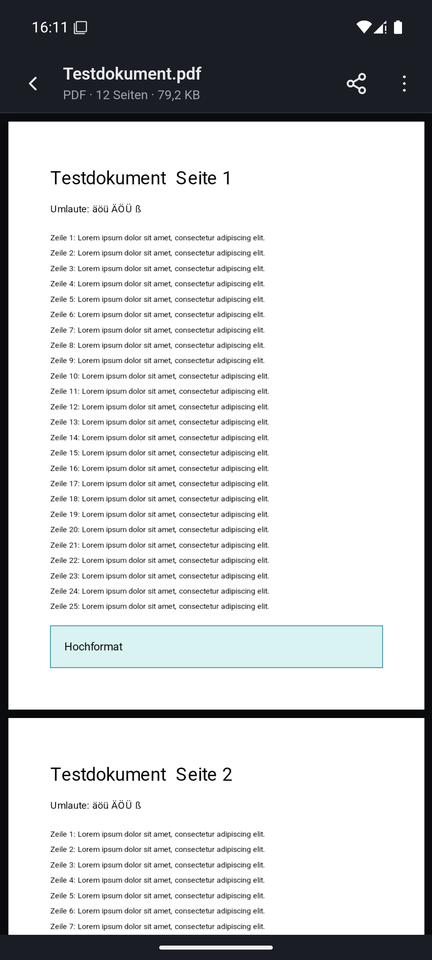
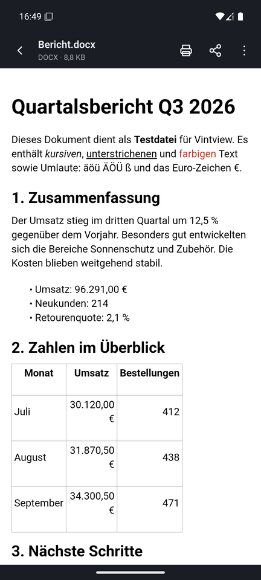

[Deutsch](README.md) · **English**

# Vintview

A lean viewer for **PDF, Word, Excel, LibreOffice and text files** on Android – fast, dark, with printing, no ads, no tracking, no account.

<p>
  
  
  
  
</p>

## Download

👉 **[Download the latest version](https://github.com/hunther2k/vintview/releases/latest)** – open `vintview-x.y.z.apk` on your phone.

The first time, Android asks whether your browser (or file manager) may **install apps** – allow it once, done.

## Features

- **PDF**: smooth scrolling, pinch zoom and double tap, sharp rendering when zoomed, page indicator with “Go to page …”, password-protected PDFs, landscape and mixed page sizes
- **Word** (`docx`, `docm`, `dotx`): headings, formatting, lists, tables, images, headers/footers and footnotes
  - **Reading mode** (text reflows when zooming – ideal on a phone) or **page view** like in Word
- **LibreOffice / OpenOffice Writer** (`odt`, `ott`): headings, formatting, lists, tables, images, footnotes
- **Legacy Word** (`doc`) and **RTF**: simplified text view (without layout and images)
- **Text** (`txt`, `md`, `log`, `json`, `xml` …): encoding (UTF-8 / Windows) is detected
- **Spreadsheets**: Excel (`xlsx`, `xlsm`, `xls`, `xlsb`), LibreOffice Calc (`ods`) and CSV/TSV
  - sheets as tabs, sticky row and column headers like in Excel
  - column widths, merged cells and hidden rows/columns from the file
  - tap a cell → full content and formula at the bottom
  - CSV: delimiter (`;` `,` tab) and encoding are detected
  - large sheets – rows load while scrolling
- **Printing** via Android's print service: Wi-Fi printers are found automatically, “Save as PDF” works too. PDFs print 1:1, all other formats as a clean black-on-white layout.
- **Open with**: open attachments from email, WhatsApp, file managers etc. directly – choose “Always” to make Vintview the default
- **Recent files**, share, pass on to another app, file info
- **In-app updates**: Vintview checks for a new version on start and installs it with one tap
- German and English (follows the phone language)

Vintview needs no storage permission: files are only read through the Android file picker or “Open with”. Documents cannot load anything from the internet. The only network access is the update check on GitHub.

## Set as default app

Android does not let apps make themselves the default:

1. Tap a PDF, Word or Excel attachment.
2. Choose **Vintview** and tap **“Always”**.

If another app opens right away, it is already the default: *Settings → Apps → (that app) → Open by default → Clear defaults.*

## Build it yourself

Requirements: JDK 17 and Android SDK (platform 35).

```bash
./gradlew assembleRelease
```

Signing via the environment variables `VV_KEYSTORE`, `VV_KEYSTORE_PASSWORD`, `VV_KEY_ALIAS` or `local.properties` (`vv.keystore`, …). Releases are built by GitHub Actions for every `v*` tag (`scripts/bump.sh`, then `scripts/release.sh "New: …"`).

## License

MIT – see [LICENSE](LICENSE). Bundled libraries: pdf.js (Mozilla), SheetJS Community Edition, docx-preview (all Apache 2.0) and JSZip (MIT) – see [THIRD_PARTY.md](THIRD_PARTY.md).
