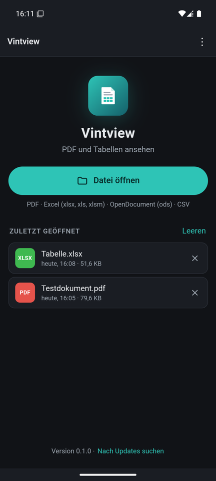
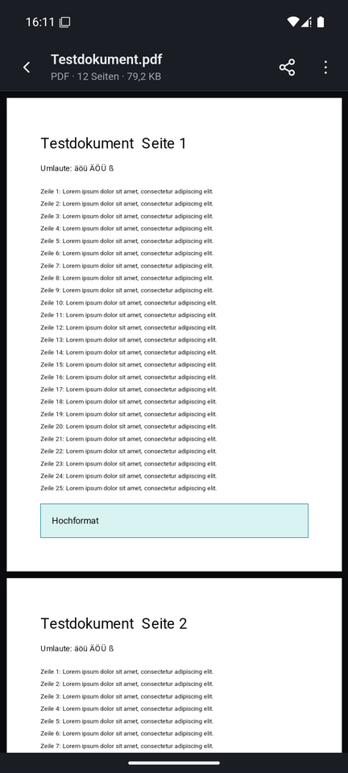
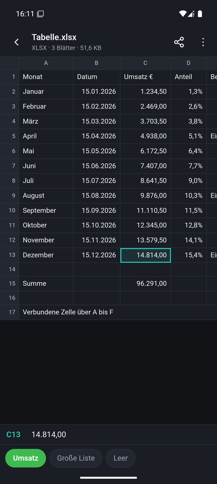

**Deutsch** · [English](README.en.md)

# Vintview

Schlanker Betrachter für **PDF- und Tabellen-Dateien** auf Android – schnell, dunkel, ohne Werbung, ohne Tracking, ohne Konto.

<p>
  
  
  
</p>

## Download

👉 **[Neueste Version herunterladen](https://github.com/hunther2k/vintview/releases/latest)** – die Datei `vintview-x.y.z.apk` auf dem Handy öffnen.

Beim ersten Mal fragt Android, ob der Browser (bzw. die Dateien-App) **Apps installieren** darf – einmal erlauben, fertig.

## Was Vintview kann

- **PDF**: alle Seiten flüssig scrollen, Zwei-Finger-Zoom und Doppeltipp, gestochen scharf auch beim Zoomen, Seitenanzeige mit „Zu Seite …“, passwortgeschützte PDFs, Querformat und gemischte Seitengrößen
- **Tabellen**: Excel (`xlsx`, `xlsm`, `xls`, `xlsb`), OpenDocument (`ods`) und CSV/TSV
  - Blätter als Reiter, feste Zeilen- und Spaltenköpfe wie in Excel
  - Spaltenbreiten, verbundene Zellen und ausgeblendete Zeilen/Spalten aus der Datei
  - Zahlen und Datumsangaben in deutscher Schreibweise
  - Zelle antippen → voller Inhalt und Formel unten
  - CSV: Trennzeichen (`;` `,` Tab) und Zeichensatz (UTF-8 / Windows) werden erkannt
  - auch große Tabellen – Zeilen werden beim Scrollen nachgeladen
- **Öffnen mit**: Anhänge aus E-Mail, WhatsApp, Dateien-App usw. direkt in Vintview öffnen – mit „Immer“ wird Vintview zur Standard-App
- **Zuletzt geöffnet**, Teilen, an andere App weitergeben, Datei-Info
- **Updates direkt in der App**: Vintview prüft beim Start auf eine neue Version und installiert sie mit einem Tipp
- Deutsch und Englisch (folgt der Handy-Sprache)

Vintview braucht keine Speicher-Berechtigung: Dateien werden ausschließlich über die Android-Dateiauswahl bzw. „Öffnen mit“ gelesen. Die einzige Internetverbindung ist die Update-Prüfung bei GitHub.

## Als Standard-App festlegen

Android lässt Apps sich nicht selbst als Standard eintragen:

1. Einen PDF- oder Excel-Anhang antippen.
2. In der Auswahl **Vintview** wählen und **„Immer“** antippen.

Öffnet sich sofort eine andere App, ist diese schon Standard: *Einstellungen → Apps → (diese App) → Standardmäßig öffnen → Standardeinstellungen löschen.*

## Selbst bauen

Voraussetzungen: JDK 17 und Android SDK (Plattform 35).

```bash
./gradlew assembleRelease
```

Signierung über Umgebungsvariablen `VV_KEYSTORE`, `VV_KEYSTORE_PASSWORD`, `VV_KEY_ALIAS` oder `local.properties` (`vv.keystore`, …). Releases baut GitHub Actions bei jedem Tag `v*` (`scripts/bump.sh`, dann `scripts/release.sh "Neu: …"`).

## Lizenz

MIT – siehe [LICENSE](LICENSE). Enthaltene Bibliotheken: pdf.js (Mozilla) und SheetJS Community Edition, beide Apache 2.0 – siehe [THIRD_PARTY.md](THIRD_PARTY.md).
